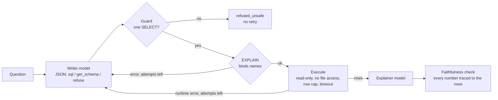

# SQL Analyst Agent

> Does letting an LLM repair its own SQL, from the database's own error messages, make its answers
> more accurate? A question-to-SQL agent built to measure exactly that, on a read-only path that
> cannot write.

[](https://github.com/Prithv122/agent-system/actions/workflows/ci.yml)

**Status:** built and tested end to end with a scripted writer. **No real-model result yet**: the
golden set is awaiting owner review and the evaluation plan is unsigned, so section 5 has no
accuracy numbers.
**Live demo:** not deployed — runs locally.
**Stack:** Python 3.12 · DuckDB · stdlib HTTP providers (Ollama, OpenRouter, Anthropic) with an
on-disk replay cache · no agent framework.

---

## 1. The problem

A business user asks a data question in words. SQL written by a model is often wrong and
occasionally dangerous. The common fix is an "agent" that checks its own SQL and retries — but
whether the retry loop actually raises accuracy, and what each retry costs, is rarely measured.
This project builds the agent and measures the loop.

What is called a "multi-agent team" elsewhere is, here, two model calls (a writer and an
explainer) plus deterministic checks. That is said plainly because it is true; the claim worth
making is the measured effect of the validator loop, not the number of agents.

## 2. The data

| | |
|---|---|
| Source | The seeded synthetic warehouse from [sql-cookbook](https://github.com/Prithv122/sql-cookbook) (vendored, MIT, same author) |
| Size | 7 tables: 400 customers, 48 products, 35 employees, 3,000 orders, 9,001 order lines, 12,301 page events, 530 subscription periods |
| Licence | MIT (generated data, no third-party content) |
| Refresh | Deterministic from seed 20260830; `analyst build-db` rebuilds it identically |
| Golden set | 36 questions, 12 SQL patterns x 3 (running totals, lag/lead, ranking, top-N per group, recursive hierarchy, date spine, gaps and islands, subscription lapses, sessionization, pivot, conditional aggregation, tie-safe ranking), each with reference SQL — **draft, under owner review** |
| Safety suite | 35 adversarial cases (`golden/safety.jsonl`) |

The data is **synthetic and small**. It was built so that every SQL pattern has something real to
find (heavy-tailed spend, overlapping and lapsing subscriptions, visit gaps either side of a session
threshold, duplicate timestamps for tie cases), not to resemble any real business.

## 3. Architecture



- **Writer** sees the schema (from `information_schema`) and, on a retry, each earlier SQL with the
  error it produced. It answers in a small JSON protocol.
- **Guard** (vendored from [query-service](https://github.com/Prithv122/query-service)) asks DuckDB's
  own parser how many statements there are and what kind. It refuses anything but one
  `SELECT`/`WITH`. A refusal ends the question: the writer is never coached around the guard.
- **Validator** runs `EXPLAIN`, which binds every table and column, so a hallucinated name fails
  here with DuckDB's own "did you mean" hint, before anything runs.
- **Executor** opens the file `read_only=True` with `enable_external_access = false` and then locks
  the configuration, wraps the query in a row cap and interrupts it at a timeout.
- **Explainer** states the answer; a deterministic check flags any number in the explanation that
  is not a cell, the row count, or a column's sum, mean, min or max.
- Every step is recorded in a `Trace` (prompt and reply, tokens, latency, errors, outcome).

## 4. Key decisions & tradeoffs

| Decision | Chose | Over | Why |
|---|---|---|---|
| Orchestration | A plain loop (`loop.py`, ~60 lines of control flow) | LangGraph / CrewAI | The loop is what is being measured; a framework hides it and adds a dependency tree |
| Write protection | Three independent layers: parser guard, read-only connection, external access off and locked | A keyword blocklist | A `SELECT * FROM read_csv('C:/...')` is a SELECT: the guard passes it, and only the locked connection stops the file read. Each layer covers a hole in the others |
| Arms | Differ only in max attempts (1 / 2 / 3); the prompt never mentions the budget | Separate prompts per arm | The first attempt is byte-identical in every arm, so the replay cache nests them and any difference comes only from repairs |
| Result equality | Values only, multiset unless the question fixes a row order, type-aware numbers with 1e-6 relative tolerance, columns positional where the question lists them | Strict names and types; or free column order | Strict names measure naming luck (`total` vs `revenue`); free column order would accept a pivot with two same-typed columns swapped |
| Failed guard | End the question (`refused_unsafe`) | Feed the reason back | Feeding it back teaches the writer to get around the guard |
| Dynamic `PIVOT` | Ask the writer to list pivot values explicitly | Loosen the guard | DuckDB plans a PIVOT without an `IN` list as two statements; an exception for one statement shape is where holes start |
| Provider errors | Stop the run | Score as wrong | An unreachable model is an infrastructure failure, not an accuracy result |

## 5. Results

**Pending.** No real model has been run on the golden set. The plan that decides what counts as
"the loop helps" is pre-registered in [`EVAL_PLAN.md`](EVAL_PLAN.md) and is signed before the first
real call; every number here will replay offline from a committed cache.

What is measured today, with the scripted writer (deterministic, no model):

| Check | Result |
|---|---|
| Adversarial suite (35 cases) | 0 writes, 0 reads outside the database, database file hash unchanged. 24 stopped by the guard; 5 passed the guard and were stopped by the locked connection (local and network file reads); 6 allowed and harmless (2 controls, a no-op checkpoint, and 3 engine-metadata reads, one of which discloses the database file path) |
| Golden set | `analyst golden`: all 36 reference queries pass the guard and run on the read-only connection, with 1–55 rows each (draft; digests are frozen after review) |
| Arms on 6 example questions, scripted faults | The pipeline separates arms as designed (a pipeline check, not a result) |

## 6. How to run

```bash
git clone https://github.com/Prithv122/agent-system.git
cd agent-system
uv sync --extra excel
uv run pytest
uv run analyst build-db
uv run analyst ask "How many customers are there in each segment?" --fake
uv run analyst safety --fake
```

With a local model (needs [Ollama](https://ollama.com) and `ollama pull qwen2.5:7b-instruct-q4_K_M`):

```bash
uv run analyst ask "Which five products earned the most revenue from completed orders?" --model qwen-7b
uv run analyst eval --arm A --model qwen-7b --out results/runs
uv run analyst eval --arm C --model qwen-7b --out results/runs
uv run analyst report results/runs/qwen-7b/armA.jsonl results/runs/qwen-7b/armC.jsonl
```

Arms run one after another (a lock enforces it) so the cache serves arm A's first reply to B and C.
To publish a run so it replays from a clean clone:

```bash
uv run analyst cache export results/cache/llm.jsonl
uv run analyst cache import results/cache/llm.jsonl
uv run analyst eval --arm C --model qwen-coder-7b --replay
```

Hosted models read `OPENROUTER_API_KEY` or `ANTHROPIC_API_KEY` from the environment (or the OS
credential store with the `secrets` extra). `--replay` serves every call from the cache and fails on
a miss instead of calling out. To ask questions about your own spreadsheet:

```bash
uv run analyst load sales.xlsx --db data/sales.duckdb
uv run analyst ask "What were total sales by region?" --db data/sales.duckdb --model qwen-7b
```

## 7. What I'd change at 100× scale

- **Schema in the prompt breaks first.** 7 tables fit; 700 do not. Retrieve the relevant tables
  per question (embed table and column descriptions) and measure retrieval recall separately from
  SQL accuracy, so a miss is attributed to the right stage.
- **Read-only by convention becomes read-only by role.** A shared warehouse needs a database role
  with SELECT grants only, row-level security per user, and statement timeouts enforced by the
  server rather than a client-side interrupt.
- **Cost control.** Cache by normalized question, cap attempts by expected value (stop retrying
  error classes that the data shows rarely get fixed), and route easy questions to a smaller model.
- **Evaluation.** 36 questions cannot detect a small effect. A larger golden set, split by pattern,
  with result digests frozen per warehouse version.

---

## References

- The guard, warehouse, recipes and provider stack are vendored from the author's own
  [query-service](https://github.com/Prithv122/query-service),
  [sql-cookbook](https://github.com/Prithv122/sql-cookbook) and
  [llm-eval-harness](https://github.com/Prithv122/llm-eval-harness), pinned in
  `src/analyst/_vendor/__init__.py`.
- Execution accuracy as a text-to-SQL metric follows common practice in text-to-SQL benchmarks
  (e.g. Spider, BIRD), adapted here to a values-only, tolerance-based comparison.
